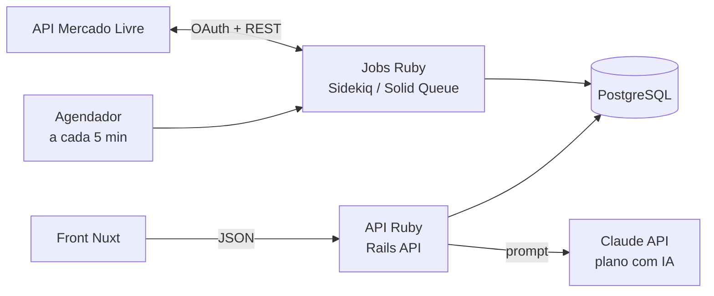
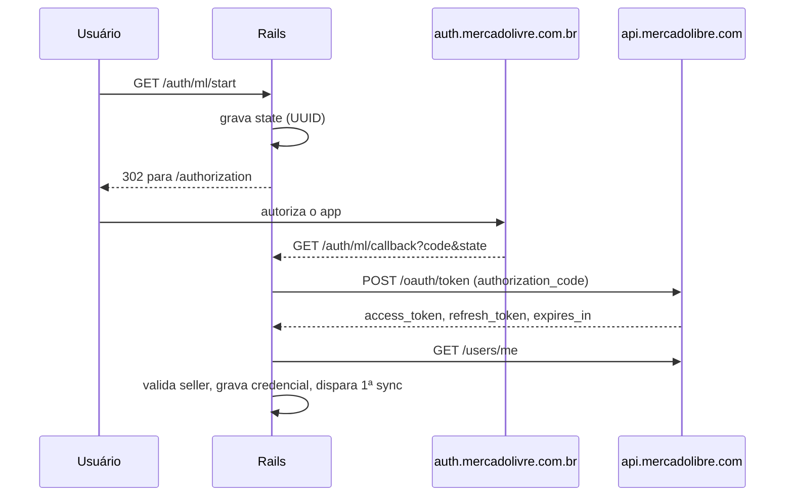

# Especificação — Painel de Anúncios ML (Nuxt + Ruby)

> Texto original da especificação (single-seller). As adaptações para SaaS multi-empresa estão em `docs/DECISOES.md` e **prevalecem** sobre este arquivo onde houver conflito.

O novo sistema reproduz o Painel de Anúncios ML da conta LUNNA_SHOP (seller 430014725): sincroniza anúncios, visitas, pedidos, qualidade, cadastro e referência de preço pela API do Mercado Livre e mostra KPIs, alertas, tabela filtrável e Curva ABC com lucro e sugestões. A primeira versão é só leitura, igual ao painel atual.

## 1. Arquitetura alvo

O back Ruby assume tudo que hoje roda em Supabase (Edge Functions, pg_cron, função SQL de snapshot) **e toda a regra de negócio que hoje roda no navegador**. O front Nuxt só exibe: não fala com o Mercado Livre e não calcula nada.

**Divisão de responsabilidades**

- **Ruby calcula**: períodos, métricas (conversão, cobertura, variações), KPIs, alertas e quem cai em cada um, Curva ABC, grupos da curva A, lucro e margem, sinalização de margem abaixo do mínimo, sugestão de preço, custo máximo, motor de sugestões, textos de diagnóstico e o prompt da IA.
- **Nuxt faz**: layout, formatação (moeda, números, datas), cores a partir de flags que vêm prontas do back (ex.: `low_margin: true`, `severity: "bad"`), abrir/fechar detalhes, capturar o que o usuário digita ou seleciona nos filtros e enviá-lo ao back, e polling. Filtro, busca, ordenação e paginação são executados no Ruby.
- Regra prática: se uma condição ou fórmula muda o que o usuário conclui ("está em queda", "margem ruim", "precisa repor"), ela mora no Ruby e chega como campo.



O fluxo é: agendador dispara o job de sincronização → job busca no ML e grava no Postgres → Nuxt pede o snapshot à API → API monta o JSON a partir do banco.

| Peça atual | Substituto no novo sistema | Observação |
| --- | --- | --- |
| Edge Function `ml-oauth-start` | `GET /auth/ml/start` (Rails) | Gera `state` e redireciona ao ML |
| Edge Function `ml-oauth-callback` | `GET /auth/ml/callback` (Rails) | Troca `code` por tokens; cadastrar esta URL como Redirect URI no DevCenter |
| Edge Function `ml-notifications` | `POST /webhooks/ml` (Rails) | Hoje só responde 200; pode disparar sync parcial no futuro |
| Edge Function `ml-sync` + cron `*/5` | `MlSyncJob` + agendador (sidekiq-cron, GoodJob ou Solid Queue recurring) | Uma rodada por vez (lock) |
| Função SQL `painel_ml_snapshot()` | Serviços Ruby de métricas + serializers | Agregações por SQL/ActiveRecord; nenhuma regra em função de banco |
| JS da página: alertas, `computeABC`, `econ`, `priceSuggestion`, `suggestions` | Serviços Ruby (ver seção 10) | Testados com RSpec; front recebe o resultado |
| Tabelas `ml_*` | Mesmas tabelas via migrations Rails | Ver seção 5 |
| Capability `sample` (Claude na página) | `POST /api/items/:id/ai-plan` chamando a Claude API | Prompt montado no Ruby; chave só no back |
| Leitura a cada 3 min pelo conector | Polling do Nuxt a cada 3 min com aba visível | Ou SSE/ActionCable depois |

Fuso de referência para todos os cálculos de dia: **America/Sao_Paulo**.

## 2. Autenticação OAuth com o Mercado Livre

A conta é conectada pelo fluxo OAuth 2.0 *authorization code*; o sistema aceita um único seller configurado (`allowed_seller_id` = 430014725) e renova o token sozinho.



**Regras**

1. **Início** — gerar `state` aleatório (UUID), gravar em `ml_oauth_states`, apagar states com mais de 1 h e redirecionar para `https://auth.mercadolivre.com.br/authorization?response_type=code&client_id=…&redirect_uri=…&state=…`. Se `ML_CLIENT_ID` ou `ML_CLIENT_SECRET` não estiverem configurados, mostrar erro de configuração.
2. **Callback** — se vier `error`, mostrar "Autorização cancelada". Sem `code` ou `state`, "Link inválido". State inexistente ou com mais de 1 h, "Autorização expirada". O state é apagado ao ser usado (uso único).
3. **Troca do código** — `POST https://api.mercadolibre.com/oauth/token` com `grant_type=authorization_code`, `client_id`, `client_secret`, `code`, `redirect_uri` (form-urlencoded). O `redirect_uri` precisa ser idêntico ao cadastrado no app.
4. **Identificação** — `GET /users/me` com o token; seller = `user_id` do token ou `id` do /me. Se diferente de `allowed_seller_id`, recusar ("Conta diferente") e não gravar.
5. **Gravação** — upsert em `ml_credentials` (seller_id, nickname, access_token, refresh_token, expires_at = agora + `expires_in` (padrão 21.600 s = 6 h), scope). Em seguida disparar a primeira sincronização em segundo plano.
6. **Sem refresh_token** — avisar que o escopo `offline_access` precisa estar ativo no app e autorizar de novo.
7. **Renovação** — no início de cada sincronização, se faltarem menos de **10 min** para expirar: `POST /oauth/token` com `grant_type=refresh_token`. Gravar o **novo access_token e o novo refresh_token** (o ML rotaciona o refresh; o antigo deixa de valer). Se falhar, a rodada termina com erro "Falha ao renovar token … Autorize de novo".
8. **Permissões do app** — leitura e escrita (mantidas para as futuras funções de edição), mais `offline_access`.

## 3. APIs do Mercado Livre usadas e como são aplicadas

São 14 endpoints, todos em `https://api.mercadolibre.com` com `Authorization: Bearer <access_token>`, exceto a tela de autorização. Todos são de leitura, menos o `/oauth/token`.

| # | Endpoint | Para que serve | Frequência | Como o dado é aplicado |
| --- | --- | --- | --- | --- |
| 1 | `GET auth.mercadolivre.com.br/authorization` | Tela de consentimento OAuth | Ao conectar/reconectar | Devolve o `code` ao callback |
| 2 | `POST /oauth/token` | Trocar `code` por tokens e renovar com `refresh_token` | Na conexão; renova quando falta < 10 min | `ml_credentials` (access, refresh, expires_at, scope) |
| 3 | `GET /users/me` | Identificar seller e nickname | Na conexão | Valida `allowed_seller_id`; nickname no cabeçalho |
| 4 | `GET /users/{seller_id}/items/search?search_type=scan&limit=100&scroll_id=…` | Listar **todos** os IDs de anúncio (qualquer status) | Toda rodada (5 min) | Base da lista de anúncios. Modo `scan` com `scroll_id` para passar do limite de 1.000 do offset |
| 5 | `GET /items?ids=ID1,…,ID20&attributes=…` | Multiget dos dados do anúncio, 20 por chamada | Toda rodada | Upsert em `ml_items`: título, status, sub_status, preço, preço original, estoque, vendidos, tipo, categoria, logística (Full), frete grátis, catálogo, SKU, variações, fotos, vídeo, marca, modelo, atributos preenchidos |
| 6 | `GET /items/{id}/visits/time_window?last=60&unit=day` | Visitas diárias dos últimos 60 dias | A cada 30 min, só ativos e pausados | `ml_item_visits` (item, dia, visitas). Alimenta visitas 7d/30d, conversão e gráfico |
| 7 | `GET /orders/search?seller={id}&order.date_created.from=…&sort=date_desc&limit=50&offset=…` | Pedidos do vendedor | Toda rodada: 62 dias na 1ª vez, depois últimos 4 dias | `ml_orders` + `ml_order_items` (quantidade, preço unitário, `sale_fee`). Base de vendas, faturamento e tarifa real |
| 8 | `GET /item/{id}/performance` | Nota de qualidade do anúncio e ações pendentes | A cada 6 h, só ativos | `quality_score`, `quality_level`, `quality_pending` (regras com status PENDING) |
| 9 | `GET /items/{id}/description` | Descrição | A cada 12 h (lotes de 60) | Só o tamanho (`description_len`); 404 = 0 caracteres |
| 10 | `GET /categories/{category_id}/attributes` | Atributos da categoria | Junto com o item 9 (cache por categoria na rodada) | Compara com os atributos preenchidos → `attrs_missing_required` e `attrs_missing_main` |
| 11 | `GET /items/{id}/sale_price?context=channel_marketplace` | Preço efetivo com promoção | A cada 12 h | `sale_price` e `regular_price`. É a única fonte confiável do preço promocional |
| 12 | `GET /sites/MLB/listing_prices?price=…&listing_type_id=…&category_id=…` | Tarifa de venda num preço | A cada 12 h, no preço efetivo e no preço sugerido | `fee_now` e `fee_at_ref` (`sale_fee_amount`, que já inclui a taxa fixa) |
| 13 | `GET /users/{seller_id}/shipping_options/free?item_id=…&free_shipping=…&item_price=…&verbose=true` | Custo de envio pago pelo vendedor | A cada 12 h, no preço efetivo e no sugerido | `ship_cost` e `ship_at_ref` (`coverage.all_country.list_cost`) |
| 14 | `GET /suggestions/items/{id}/details` | Referência de preço e concorrentes | A cada 12 h | `price_ref`: status, preço atual, sugerido, menor, % diferença, qtd. comparados, até 8 concorrentes (preço, título, vendidos). 404 = sem referência |

**Campos pedidos no multiget (item 5):** `id,title,status,sub_status,price,original_price,available_quantity,sold_quantity,listing_type_id,category_id,shipping,catalog_listing,permalink,thumbnail,seller_custom_field,attributes,variations,pictures,video_id,health,date_created,last_updated`.

**Regras de aplicação dos dados**

- **SKU**: `seller_custom_field` do item; senão o atributo `SELLER_SKU`; senão o `seller_custom_field` ou `SELLER_SKU` da primeira variação.
- **Tipo de anúncio**: `gold_pro` = Premium (P); `gold_special` = Clássico (C).
- **Full**: `shipping.logistic_type = fulfillment`.
- **Atributo preenchido**: tem `value_id`, ou `value_name` não vazio, ou `values` com itens. Atributos de variação (`attribute_combinations`) também contam.
- **Atributos considerados** na comparação com a categoria: excluir os com tag `read_only`, `hidden`, `fixed` e o `SELLER_SKU`. Obrigatório = tag `required` ou `catalog_required`. Principal = `relevance = 1` e não obrigatório. Guardar até 15 nomes de cada.
- **Pedidos**: só entram nas métricas pedidos com `status = paid`. Linhas do mesmo pedido e mesmo anúncio são somadas (variações diferentes viram uma linha).
- **Preço efetivo** = `sale_price.amount` se > 0; senão `price` do item. A tarifa e o frete atuais são consultados nesse preço.
- **Frete no preço sugerido**: consultar com `free_shipping=true` quando o sugerido for ≥ R$ 79 (frete grátis obrigatório); abaixo disso, manter a configuração atual do anúncio.
- **Tarifa/frete no sugerido** só são consultados se o sugerido for > 0 e diferente do preço efetivo (> R$ 0,009); senão ficam nulos.

**Fatos da API já verificados**

- `listing_prices.sale_fee_amount` bateu com o `sale_fee` dos pedidos reais.
- `shipping_options/free` com `free_shipping=false` devolve o custo operacional que o vendedor paga mesmo assim.
- Visitas do dia corrente consolidam com atraso; o dia de hoje sempre parece baixo.
- A API conta 249 anúncios; o painel do vendedor agrupa em 145 linhas (itens de catálogo e variantes).

## 4. Rotina de sincronização

Um job roda a cada **5 minutos** e executa as etapas abaixo em ordem; as etapas pesadas têm frequência própria e só rodam quando vencidas.

| Etapa | Frequência | Escopo | Paralelismo / lote |
| --- | --- | --- | --- |
| 0. Renovar token | Se faltar < 10 min | Credencial do seller permitido | — |
| 1. Listar IDs (scan) | Toda rodada | Todos os anúncios | 100 por página, até 100 páginas |
| 2. Multiget + upsert `ml_items` | Toda rodada | Todos | 20 por chamada; upsert de 200 em 200 |
| 3. Visitas 60 dias | A cada 30 min (`last_visits_ms`) | Ativos e pausados | 5 simultâneos; upsert de 500 em 500 |
| 4. Pedidos | Toda rodada | 62 dias até `orders_backfilled=1`; depois 4 dias | 50 por página, offset até 9.950 |
| 5. Qualidade | Cada anúncio a cada 6 h | Ativos, até 200 por rodada | 5 simultâneos |
| 6. Cadastro e preço | Cada anúncio a cada 12 h | Ativos, pausados, em revisão; os mais antigos primeiro | 60 por rodada, 4 simultâneos |

**Regras**

- **Uma rodada por vez**: se existir rodada iniciada há menos de 6 min e não terminada, a nova é ignorada ("rodada anterior ainda em andamento"). No Ruby, usar lock (advisory lock do Postgres ou `sidekiq-unique-jobs`).
- **Log**: cada rodada grava em `ml_sync_runs` início, fim, `ok`, qtd. de anúncios, qtd. de pedidos e `detail` com avisos (máx. 2.000 caracteres).
- **Retentativa**: HTTP 429 ou 5xx → até 3 tentativas com espera de 0,9 s × número da tentativa. Outros erros (4xx) não repetem e viram aviso no log.
- **Falha parcial** não derruba a rodada: erro num anúncio ou numa etapa vira nota e as demais seguem. Só falha de token encerra a rodada com `ok=false`.
- **Backfill de pedidos** só é marcado como feito se a carga de 62 dias terminou sem erro.
- **Paginação de pedidos** para quando a página vier com menos de 50 ou o offset alcançar `paging.total`.
- **Carimbos**: `quality_checked_at` e `details_checked_at` são gravados mesmo quando a API falha, para não repetir o mesmo anúncio em loop.
- **Disparo manual**: a primeira sincronização é disparada logo após o OAuth; também deve haver um disparo manual (job enfileirado por endpoint administrativo protegido).
- **Autenticação do disparo**: hoje por cabeçalho `x-sync-secret`. No Ruby o job é interno; se houver endpoint HTTP de disparo, proteger com segredo ou usuário admin.

## 5. Modelo de dados

Sete tabelas de domínio mais duas de controle; os nomes podem ser mantidos nas migrations Rails para facilitar a migração dos dados atuais.

| Tabela | Chave | Colunas principais | Origem |
| --- | --- | --- | --- |
| `ml_credentials` | seller_id | nickname, access_token, refresh_token, expires_at, scope, updated_at | OAuth. Tokens criptografados (Active Record Encryption) |
| `ml_oauth_states` | state | created_at | OAuth; expira em 1 h |
| `ml_app_config` | key | value | `allowed_seller_id`=430014725, `tax_pct`=11.3, `min_margin_pct`=9, `orders_backfilled`, `last_visits_ms` |
| `ml_items` | item_id | seller_id, title, status, sub_status (json), price, original_price, sale_price, regular_price, available_quantity, sold_quantity, listing_type_id, category_id, logistic_type, free_shipping, catalog_listing, sku, variations_count, permalink, thumbnail, health, pictures_count, has_video, attrs_filled, attrs_missing_required (json), attrs_missing_main (json), brand, model, description_len, quality_score, quality_level, quality_pending (json), fee_now, ship_cost, price_ref (json), fee_at_ref, ship_at_ref, date_created, last_updated, details_checked_at, quality_checked_at, synced_at | Endpoints 5, 8–14 |
| `ml_item_visits` | (item_id, day) | visits | Endpoint 6 |
| `ml_orders` | order_id | seller_id, status, date_created, date_closed, total_amount, synced_at | Endpoint 7 |
| `ml_order_items` | (order_id, item_id) | quantity, unit_price, sale_fee | Endpoint 7 |
| `ml_costs` | sku | cost, extra (embalagem/outros), source, updated_at | ERP (a integrar). Vazia hoje |
| `ml_sync_runs` | id | started_at, finished_at, ok, items, orders, detail | Job de sincronização |

**Estrutura de `price_ref` (json)**: status, current, suggested, lowest, internal, pct, applicable, selling_fees, shipping_fees, compared, graph[] (até 8: p = preço, t = título, s = vendidos), updated.

**Estrutura de `quality_pending` (json)**: lista de { area, key, title, label, mode } — uma entrada por regra com status `PENDING` em `buckets[].variables[].rules[]`.

**Regra de custo**: custo usado no lucro = `cost + extra` do SKU do anúncio. Anúncio sem SKU ou SKU sem linha em `ml_costs` = sem custo.

## 6. Períodos e indicadores

Todas as janelas são de dias fechados no fuso de São Paulo, sem contar hoje (exceto "hoje"). Vendas e faturamento vêm só de pedidos pagos.

| Período | Chave | Intervalo (D = hoje) |
| --- | --- | --- |
| Hoje | today | D |
| Semana atual | c_from..c_to | D−7 a D−1 |
| Semana anterior | p_from..p_to | D−14 a D−8 |
| Mês atual (30d) | m_from..m_to | D−30 a D−1 |
| Mês anterior (30d) | pm_from..pm_to | D−60 a D−31 |
| Gráfico | daily | D−14 a D (15 dias) |

| Indicador | Chave | Fórmula |
| --- | --- | --- |
| Visitas | v7, pv7, v30, pv30 | Soma de `ml_item_visits.visits` no período |
| Vendas (un.) | u7, pu7, u30, pu30, ut | Soma de `quantity` dos pedidos pagos no período (ut = hoje) |
| Faturamento | r7, r30, pr30 | Soma de `quantity × unit_price` |
| Faturado após tarifa | n7 | Soma de `quantity × (unit_price − sale_fee)` — ainda sem frete |
| Tarifas reais 30d | f30 | Soma de `quantity × sale_fee` |
| Conversão | conv | vendas ÷ visitas × 100 (nula se visitas = 0) |
| Variação semanal | d | u7 − pu7 (em unidades) |
| Cobertura de estoque (7d) | cover | estoque ÷ (u7 ÷ 7), em dias; nula se u7 = 0 |
| Cobertura de estoque (30d) | — | estoque ÷ (u30 ÷ 30); usada nas sugestões da Curva ABC |
| Variação % KPI | delta | (atual − anterior) ÷ anterior × 100; conversão em pontos percentuais (atual − anterior) |
| Preço de venda | price | `sale_price` se existir e diferente de `price`; senão `price` |

**Regras de exibição de variação**: |delta| < 0,5 → neutro (cinza); positivo → verde; negativo → vermelho. Sem valor anterior, não mostra variação.

**Formato**: moeda BRL (pt-BR), inteiros com separador de milhar, percentuais com 1 casa. Status traduzidos: active = Ativo, paused = Pausado, closed = Finalizado, under_review = Em revisão, inactive = Inativo.

**Payload enxuto**: anúncios finalizados/inativos sem faturamento nos últimos 60 dias vêm só com id, título, status, SKU, preço, estoque, tipo e Full. Ordem padrão: faturamento 30d, vendas 7d, visitas 7d (decrescente).

## 7. Funcionalidades do painel e regras

O painel tem seis blocos, de cima para baixo: cabeçalho com status, KPIs, gráfico de 15 dias, três listas (mais vendidos, atenção, últimas vendas), Curva ABC e tabela completa.

Todas as condições e fórmulas desta seção são executadas no Ruby; o Nuxt recebe os valores e flags prontos e só os exibe. Onde o texto diz "verde/amarelo/vermelho", o back envia o estado (`ok`, `warn`, `bad`) e o front escolhe a cor.

### 7.1 Cabeçalho e status da sincronização

- Mostra "Mercado Livre · {nickname}" e o resumo: total de anúncios, ativos, pausados, finalizados (closed + inactive), em revisão e as datas da semana atual vs. anterior.
- Selo de status: "Sincronizado às HH:MM (há N min) · consultado às HH:MM", usando a última rodada com `ok=true`.
- **Verde** quando a última rodada deu certo e foi há ≤ 20 min. **Amarelo** quando a última rodada falhou (aviso "A última sincronização falhou" + detalhe; os números são da última que deu certo) ou quando passou de 20 min ("Sincronização atrasada").
- Botão **Atualizar agora** relista o snapshot. Atualização automática a cada **3 min** só com a aba visível; ao voltar para a aba, atualiza na hora. Não dispara duas leituras simultâneas.
- Erro de leitura com dados já carregados: manter os últimos dados e avisar "mostrando os últimos dados". Erro temporário (indisponível, limite) tenta de novo uma vez após ~3–5 s.

### 7.2 KPIs

| Cartão | Valor | Comparação |
| --- | --- | --- |
| Hoje até agora | Faturamento de hoje | un. vendidas e nº de pedidos de hoje |
| Vendas · 7 dias | Soma u7 | % vs. soma pu7 |
| Faturado · 7 dias | Soma r7 | % vs. faturamento da semana anterior (do gráfico diário) |
| Visitas · 7 dias | Soma v7 | % vs. soma pv7 |
| Conversão | Soma u7 ÷ soma v7 | pontos percentuais vs. semana anterior |
| Estoque dos ativos | Soma do estoque dos ativos | quantidade de anúncios ativos no Full |

### 7.3 Gráfico de 15 dias

- Duas séries em barras por dia: unidades vendidas (em cima, com rótulo do valor) e visitas (embaixo). Hoje destacado.
- Escala: unidades arredondadas para cima em múltiplos de 10; visitas em múltiplos de 500.
- Dica ao passar o mouse: dia, un., faturamento, pedidos; e visitas.
- Por dia: v = visitas de todos os anúncios; u = unidades pagas; r = faturamento; o = pedidos distintos.

### 7.4 Mais vendidos

- Top 10 por vendas 7d (desempate: semana anterior), só quem vendeu em uma das duas semanas.
- Barra dupla: semana atual e anterior, na escala do maior valor. Clique abre o anúncio na tabela (limpa filtros e rola até ele).

### 7.5 Precisa de atenção (alertas)

Cada alerta mostra a contagem e, ao clicar, filtra a tabela por ele (chip removível). Alertas com zero não aparecem.

| Alerta | Severidade | Regra |
| --- | --- | --- |
| Ativos sem estoque | Alta | status = active e estoque = 0 |
| Em revisão pelo Mercado Livre | Alta | status = under_review |
| Vendas caíram na semana | Alta | ativo e pu7 − u7 ≥ 3 |
| Estoque para menos de 14 dias | Média | ativo e cobertura 7d < 14 dias |
| Visitas sem venda | Média | ativo, v7 ≥ 30 e u7 = 0 |
| Qualidade abaixo de 70 | Info | ativo e nota de qualidade < 70 |
| Pausados que vendiam | Info | status = paused e pu7 > 0 |

### 7.6 Últimas vendas

- As 10 linhas de pedido pagas mais recentes: data/hora (DD/MM HH:MM), quantidade ("2×" quando > 1), título e valor (preço × quantidade).

### 7.7 Tabela completa de anúncios

**Colunas**: Anúncio (título, ID, selo Full), SKU (ou "sem SKU"), Status, Preço (com "de" preço original e tipo Premium/Clássico), Estoque, Visitas 7d, Vendas 7d (+N hoje), Conversão, Variação (u7 − pu7), Faturado 7d, Cobertura (dias), Qualidade (barra: ≥ 80 verde, ≥ 60 amarelo, < 60 vermelho).

**Destaques**: estoque 0 em ativo e cobertura < 14 dias em vermelho; variação positiva verde, negativa vermelha.

**Filtros**

- Abas de status: Ativos (padrão), Pausados, Finalizados (closed + inactive + under_review), Todos — com contagem.
- Busca livre em título, ID e SKU. Selects de Tipo (Premium/Clássico) e Envio (Full / fora do Full).
- Filtro por coluna: texto em Anúncio (título ou ID) e SKU ("sem sku" traz os sem SKU); Status em lista; colunas numéricas aceitam `>10`, `<5`, `>=`, `<=`, `=0`, faixa `10-50` / `10 a 50` / `10 até 50`, e números no formato BR (`1.234,56`, `R$`, `%` ignorados). Expressão inválida deixa o campo vermelho e é ignorada.
- Todos os filtros são aplicados no Ruby (`GET /api/items`, seção 10.4): o Nuxt envia os valores após 300 ms sem digitação e cancela a requisição anterior se ainda estiver em curso. Botão "Limpar filtros (N)" aparece quando há filtros.
- Variação só é filtrável para quem vendeu em alguma das duas semanas.

**Ordenação**: clique no cabeçalho alterna crescente/decrescente. Padrão: Vendas 7d decrescente. Texto, status, SKU e cobertura começam crescentes; os demais decrescentes. Nulos sempre no fim. Desempate por visitas 7d. A ordenação também é feita no Ruby (parâmetros `sort` e `dir`).

**Detalhe do anúncio** (clique na linha abre/fecha):

- Preço e oferta: preço, preço original com % de desconto, tipo, frete (grátis / pago pelo comprador), logística (Full ou não).
- Desempenho 7 dias (atual / anterior): visitas, vendas, conversão, faturado, após tarifa ML (sem frete), vendidos hoje.
- Estoque e cadastro: disponível, cobertura, SKU, variações, catálogo.
- Qualidade: nota/100, nível e até 6 ações pendentes do ML; sem nota → "O Mercado Livre não calculou".
- Links: anúncio publicado (`https://produto.mercadolivre.com.br/MLB-{número}`) e painel do vendedor (`https://www.mercadolivre.com.br/anuncios/lista?search={id}`).

## 8. Curva ABC

A Curva ABC classifica os anúncios pelo faturamento dos últimos 30 dias e, para cada um, calcula lucro, margem, sugestão de preço e uma lista priorizada de ações. Parâmetros vigentes: imposto **11,3%**, margem líquida mínima **9%**.

Classificação, grupos, lucro, preço sugerido e sugestões são calculados no Ruby a cada sincronização concluída e entregues prontos (seção 10). Os parâmetros (imposto, margem mínima, cortes 80/95, limites −15%/+10%) ficam em `ml_app_config`, nunca fixos no front.

### 8.1 Classificação

- **Universo**: todos os anúncios, exceto finalizados/inativos que não faturaram nos últimos 60 dias.
- Ordenar por faturamento 30d (r30) decrescente; participação = r30 ÷ total × 100; acumulado soma na ordem.
- A curva usa o acumulado **antes** do anúncio: < 80% → **A**; < 95% → **B**; resto → **C**. Sem faturamento → sempre **C**.
- Resumo no topo: por curva, quantidade de anúncios, faturamento e % do total.
- Abas: Todos, Curva A, Curva B, Curva C (com contagem).

### 8.2 Grupos da Curva A

Variação = (u30 − pu30) ÷ pu30 × 100. Sem venda anterior e com venda atual = "novo" (conta como Vendendo). Sem nenhuma venda = Estagnado.

| Grupo | Regra |
| --- | --- |
| Vendendo | variação ≥ +10% |
| Estagnados | entre −15% e +10% |
| Em queda | variação < −15% |

Na aba Curva A os anúncios aparecem em três blocos (Vendendo, Estagnados, Em queda), cada um com contagem e faturamento.

### 8.3 Tabela da Curva ABC

Colunas: Curva, Anúncio (ID, status, Full, grupo se A), SKU, Visitas 30d, Vendas 30d, vs. anterior (vermelho < −15%, verde ≥ +10%), Conversão, Faturamento 30d (% do total), Lucro/mês ("Lucro líq./mês" quando houver custos), Margem, Ações (quantidade de sugestões e quantas urgentes).

### 8.4 Lucro e margem

Por unidade, no preço de venda atual:

```
sobra  = P − tarifa − frete − P × imposto
lucro  = sobra − custo
margem = lucro ÷ P × 100
```

- **P** = preço promocional se houver, senão o preço.
- **Tarifa por unidade** = `fee_now` (tarifa no preço atual); sem ela, f30 ÷ u30.
- **Frete por unidade** = `ship_cost` (estimativa por anúncio).
- **Custo** = cost + extra do SKU.

No mês (30 dias): faturamento − tarifas reais dos pedidos (f30; sem elas, tarifa unit. × u30) − frete unit. × u30 − faturamento × imposto − custo × u30. Margem do mês = lucro ÷ faturamento.

**Regras de exibição**

- Sem nenhum custo cadastrado: aviso "Custos dos produtos ainda não cadastrados"; o lucro aparece como **"lucro antes do custo"** e os alertas de margem mínima não valem.
- Com custo: margem < 9% em vermelho. Lucro negativo sempre em vermelho.
- Enquanto os detalhes de cadastro não chegaram para todos, mostrar "Detalhes carregados para X de Y anúncios".

### 8.5 Sugestão de preço (referência do Mercado Livre)

- Só existe se o ML devolveu preço sugerido. Diferença < 0,5% → "alinhado à referência".
- No preço sugerido S: tarifa = `fee_at_ref` (senão tarifa atual × S ÷ P); frete = `ship_at_ref` (senão frete atual); imposto = S × 11,3%.
- Com custo: lucro e margem em S; se margem < 9% → quadro vermelho "Abaixo da margem mínima".
- Sem custo: **custo máximo** que mantém a margem mínima:

```
custo máx = S × (1 − imposto − margem mínima) − tarifa_S − frete_S
```

- Custo máximo ≤ 0 → aviso "tarifa, frete e imposto já consomem a margem mínima".
- Mostra até 5 concorrentes comparados (preço e título) e o menor preço visto.

| Status do ML | Texto exibido |
| --- | --- |
| with_benchmark_highest | acima do preço de todos os concorrentes comparados |
| with_benchmark_high | acima do preço de referência dos concorrentes |
| no_benchmark_ok | alinhado ao preço de referência |
| no_benchmark_lowest | abaixo da referência — o mais barato entre os comparados |
| promotion_active / promotion_scheduled / not_optin_applied | promoção sugerida ativa / agendada / não aplicada |

### 8.6 Motor de sugestões

Cada anúncio recebe sugestões com prioridade 1 (urgente), 2 ou 3, ordenadas por prioridade. Conversão mediana da loja = mediana entre anúncios com ≥ 100 visitas em 30d.

| Área | Regra (quando dispara) | Prioridade |
| --- | --- | --- |
| Status | Pausado e vendeu nos últimos 60 dias → reativar | 1 |
| Moderação | Em revisão → resolver no painel do vendedor | 1 |
| Estoque | Ativo com estoque 0 → repor (Full: programar envio) | 1 |
| Estoque | Cobertura 30d < 20 dias | 1 se < 10 dias, senão 2 |
| Preço | Sugerido abaixo do atual → avaliar reduzir | 1 se status "highest" ou conversão < 70% da mediana; senão 2 |
| Preço | Sugerido acima do atual → espaço para subir | 2 |
| Exposição | Curva A em queda e visitas 30d caíram > 15% | 1 |
| Conversão | Curva A em queda e conversão < 80% da anterior | 1 |
| Conversão | Ativo, ≥ 100 visitas e conversão < 60% da mediana (fora do grupo em queda) | 2 |
| Exposição | Ativo com < 60 visitas em 30d | 1 se curva C, senão 2 |
| Título | Título < 40 caracteres | 2 |
| Título | Marca não aparece no título | 2 |
| Título | Modelo (> 2 caracteres) fora do título e título < 55 caracteres | 3 |
| Política ML | Título contém: frete grátis/gratis, promoção/promocao, oferta, desconto, barato, imperdível, queima, liquidação | 1 |
| Ficha técnica | Atributos obrigatórios faltando (lista os nomes) | 1 |
| Ficha técnica | Características principais faltando (lista os nomes) | 2 |
| Fotos | < 3 fotos | 1 |
| Fotos | 3 a 5 fotos (meta 6–10) | 2 |
| Vídeo | Sem vídeo e curva A ou B | 3 |
| Descrição | Sem descrição | 1 |
| Descrição | Descrição < 400 caracteres | 2 |
| Tipo de anúncio | Clássico, preço ≥ R$ 120, curva A/B e o ML recomenda parcelamento → testar Premium | 3 |
| Frete | Sem frete grátis e preço entre R$ 60 e R$ 79 → testar frete grátis | 3 |
| Logística | Fora do Full, curva A e ≥ 30 vendas/mês → avaliar Full | 2 |
| Qualidade ML | Cada recomendação pendente do ML (sem repetir) | 2 se nota < 70, senão 3 |
| Estratégia | Curva C, ativo, sem venda no mês e ≥ 60 visitas → liquidação ou unificar | 2 |
| Dados | Detalhes de cadastro ainda não carregados | 3 |

### 8.7 Detalhe do anúncio na Curva ABC

Ao abrir a linha: Indicadores 30d (atual / anterior, participação e acumulado), Resultado do mês (faturamento, tarifas, frete, imposto, custo, lucro, margem), Por unidade (preço, tarifa, frete, imposto, custo, lucro/sobra, margem), Cadastro (estoque, fotos, vídeo, descrição, título x/60, qualidade, tipo), a lista "O que fazer para vender mais", o quadro de preço e o botão de plano com IA.

## 9. Plano de ação com IA

No detalhe de cada anúncio da Curva ABC, o botão **Plano de ação detalhado com IA** envia os dados do anúncio a um modelo de linguagem e mostra a resposta em streaming. Só roda com clique (tem custo por chamada).

**Regras**

- No novo sistema a chamada sai do back Ruby (`POST /api/items/:id/ai-plan`) para a Claude API, com a chave só no servidor. Resposta em streaming (SSE) para o Nuxt.
- Botões: "Plano de ação detalhado com IA" → durante a geração "Parar" (cancela) → depois "Gerar de novo". O resultado fica em memória por anúncio enquanto a página está aberta.
- Mensagens de erro: sem permissão, limite de uso ("tente em instantes"), cancelado ("Interrompido"), genérico.
- Ao terminar: "Plano gerado a partir dos dados deste anúncio. Revise antes de aplicar." A IA não altera nada no ML.

**Dados enviados (JSON)**: título, SKU, status, curva, grupo da curva A, preço de venda, preço cheio, tipo, Full, frete grátis, estoque, visitas e vendas 30d (atual e anterior), conversão 30d e mediana da loja, faturamento 30d, tarifa e frete por unidade, imposto %, custo, margem mínima, lucro do mês / lucro antes do custo, fotos, vídeo, tamanho da descrição, qualidade, marca, modelo, atributos faltando, recomendações do ML, referência de preço (sugerido, variação, margem no sugerido, custo máximo, concorrentes) e o diagnóstico automático (todas as sugestões da seção 8.6).

**Instruções ao modelo**: especialista em vendas no Mercado Livre Brasil; usar só os dados enviados; seguir as políticas do ML (título ≤ 60 caracteres sem termos promocionais/frete, capa com fundo branco sem texto/logo, descrição sem links/contatos, ficha completa). Formato em texto simples:

1. Diagnóstico em 2 frases.
2. Até 5 ações priorizadas (o quê, por quê, impacto).
3. Título sugerido (≤ 60) e 2 alternativas.
4. Estrutura da descrição e fotos que faltam.
5. Preço: manter, subir ou reduzir; com custo, a margem resultante e alerta se < margem mínima; sem custo, o custo máximo.

Não inventar números que não estejam nos dados.

## 10. Contrato da API Ruby consumida pelo Nuxt

O back expõe três leituras já calculadas — painel, Curva ABC e detalhe do anúncio — e o Nuxt apenas renderiza o que recebe. Os resultados são recalculados ao fim de cada sincronização e guardados em cache pela id da rodada.

### 10.1 Serviços Ruby (regra de negócio)

| Serviço | Responsabilidade | Seção da regra |
| --- | --- | --- |
| `Painel::Periods` | Calcula today, semana atual/anterior, 30d atual/anterior no fuso de São Paulo | 6 |
| `Painel::ItemMetrics` | Agrega visitas, vendas, faturamento, tarifas por anúncio; conversão, variação, cobertura 7d e 30d, preço de venda | 6 |
| `Painel::Kpis` | Seis cartões com valor, comparação e direção do delta (`up`/`down`/`flat`) | 7.2 |
| `Painel::SyncStatus` | Estado do selo (`ok`/`warn`/`bad`), minutos desde a última sync, aviso a exibir | 7.1 |
| `Painel::Alerts` | Os 7 alertas: contagem, severidade e lista de IDs de cada um | 7.5 |
| `Painel::TopSellers`, `Painel::RecentSales`, `Painel::Daily` | Top 10, últimas 10 vendas, série de 15 dias com escalas | 7.3, 7.4, 7.6 |
| `Abc::Classifier` | Universo, participação, acumulado, curva A/B/C, grupo da curva A, mediana de conversão | 8.1, 8.2 |
| `Abc::Economics` | Lucro/sobra e margem por unidade e no mês; flag `low_margin` | 8.4 |
| `Abc::PriceSuggestion` | Preço sugerido, diferença, tarifa/frete/imposto no sugerido, margem, custo máximo, flag `low`, texto do status | 8.5 |
| `Abc::SuggestionEngine` | As 28 regras com área, título, justificativa e prioridade, já ordenadas | 8.6 |
| `Ai::ActionPlanPrompt` | Monta o JSON de dados e o prompt; `Ai::ActionPlan` chama a Claude API e faz streaming | 9 |
| `Painel::ItemQuery` + `Painel::FilterExpression` | Filtros, busca, expressões numéricas, ordenação, paginação e contagens da tabela; valida expressões e devolve as inválidas | 7.7 |

Cada serviço recebe dados e parâmetros (`ml_app_config`) e devolve estruturas simples, com testes unitários cobrindo os limites de cada regra (ex.: acumulado exatamente 80%, variação exatamente −15%).

### 10.2 Endpoints

| Método e rota | Uso | Resposta |
| --- | --- | --- |
| `GET /api/painel` | Cabeçalho, KPIs, gráfico, listas e alertas | JSON 10.3 |
| `GET /api/items` | Tabela de anúncios com filtros, busca, ordenação e paginação | JSON 10.4 |
| `GET /api/abc?curve=all\|A\|B\|C` | Resumo e linhas da Curva ABC | JSON 10.5 |
| `GET /api/abc/items/:id` | Detalhe do anúncio na Curva ABC | JSON 10.6 |
| `POST /api/items/:id/ai-plan` | Plano com IA | Stream SSE de texto |
| `POST /api/sync` (admin) | Disparar sincronização manual | 202 + id da rodada; 409 se já houver uma rodando |
| `GET /api/sync/runs?limit=20` | Histórico de rodadas | Lista de `ml_sync_runs` |
| `GET /auth/ml/start`, `GET /auth/ml/callback` | Conectar a conta | Redirecionamento / página de resultado |
| `POST /webhooks/ml` | Notificações do ML | 200 imediato |

### 10.3 `GET /api/painel`

- `account`, `generated_at`, `period` {today, week, prev_week, month, prev_month} com início e fim.
- `sync` {state: ok|warn|bad, last_ok_at, minutes_ago, notice: {title, body} ou null}.
- `summary` {total, active, paused, closed, under_review}.
- `kpis[]` {key, label, value, value_type: money|int|pct, sub_label, delta: {value, unit: pct|pp, direction: up|down|flat} ou null}.
- `daily[]` {day, units, revenue, orders, visits, is_today} + `daily_scale` {units_max, visits_max}.
- `top_sellers[]` {id, title, units_week, units_prev_week, bar_pct, bar_prev_pct}.
- `alerts[]` {key, title, description, severity: bad|warn|info, count} — só os com count > 0.
- `recent_sales[]` {at, item_id, title, quantity, total}.

### 10.4 `GET /api/items`

Toda a filtragem, busca, ordenação e paginação da tabela acontece aqui. O Nuxt só repassa o estado dos controles como query params e desenha a resposta.

| Parâmetro | Valores | Regra aplicada no Ruby |
| --- | --- | --- |
| `status` | active (padrão), paused, closed, all | `closed` inclui closed, inactive e under_review |
| `alert` | chave de um alerta (ex.: `nostock`) | Aplica a regra do alerta (7.5) e **ignora** `status` |
| `q` | texto | Contém, sem diferenciar maiúsculas, em título, ID ou SKU |
| `type` | P, C | Tipo Premium / Clássico |
| `shipping` | full, non_full | Full ou fora do Full |
| `f[title]` | texto | Contém em título ou ID |
| `f[sku]` | texto | Contém no SKU; valor `sem sku` traz os anúncios sem SKU |
| `f[price]`, `f[stock]`, `f[visits_7d]`, `f[units_7d]`, `f[conversion_7d]`, `f[units_delta]`, `f[revenue_7d]`, `f[coverage_days]`, `f[quality_score]` | expressão | Ver gramática abaixo; `units_delta` só considera quem vendeu em alguma das duas semanas |
| `id` | ID do anúncio | Traz só esse anúncio, ignorando os demais filtros (usado ao clicar em Mais vendidos) |
| `sort` | nome de qualquer coluna | Padrão `units_7d` |
| `dir` | asc, desc | Padrão: asc para title, status, sku e coverage_days; desc para os demais |
| `page`, `per_page` | inteiros | Padrão 1 e 50; máximo 200 |

**Gramática das expressões numéricas** (`Painel::FilterExpression`):

- Operadores `>`, `<`, `>=`, `<=`, `=`; sem operador = igual (tolerância 1e-9).
- Faixa `10-50`, `10 a 50` ou `10 até 50` (inclusiva, aceita os extremos em qualquer ordem).
- Números no formato BR: `1.234,56`; `R$`, `%` e espaços são ignorados.
- Valor nulo nunca passa num filtro numérico.
- Expressão inválida é ignorada no filtro e devolvida em `invalid_filters` para o front marcar o campo em vermelho.

**Ordenação**: texto por collation pt-BR, números por valor, nulos sempre no fim (nas duas direções), desempate por `visits_7d` decrescente.

**Resposta**

- `items[]`: id, title, status, status_label, sku, price, original_price, discount_pct, listing_type_label, full, free_shipping, catalog, variations, stock, stock_state (`ok`|`bad`), visits_7d, prev_visits_7d, units_7d, prev_units_7d, units_today, conversion_7d, prev_conversion_7d, units_delta, units_delta_direction, revenue_7d, net_after_fee_7d, coverage_days, coverage_state, quality_score, quality_state, quality_level, quality_actions[], alert_keys[], links {public, seller_panel}.
- `total` (após filtros), `page`, `per_page`.
- `status_counts` {active, paused, closed, all} para as abas (sem os demais filtros).
- `active_filter` {alert: {key, title} ou null}, `active_filters_count` (para o botão "Limpar filtros (N)"), `invalid_filters[]` (chaves com expressão inválida), `sort`, `dir` efetivos.

Implementação: filtros sobre a visão materializada ou tabela de métricas por anúncio recalculada a cada sincronização (`item_metrics`), para que filtros numéricos e ordenação virem SQL com índice, e não cálculo em memória.

### 10.5 `GET /api/abc`

- `params` {tax_pct, min_margin_pct, cut_a, cut_b, up_pct, down_pct}, `period`, `has_costs`, `details` {done, total}, `notice` (aviso de custos/detalhes ou null).
- `summary[]` por curva {curve, count, revenue, share_pct}.
- `groups` (só curva A) {up, flat, down} com {label, description, count, revenue}.
- `rows[]` {id, title, status_label, sku, full, curve, group, rank, share_pct, cum_pct, visits_30d, units_30d, units_change_pct, units_change_state, is_new, conversion_30d, revenue_30d, profit_month, profit_is_before_cost, margin_pct, margin_state, suggestions_count, urgent_count}.

### 10.6 `GET /api/abc/items/:id`

- `indicators` {visits, prev_visits, units, prev_units, conversion, revenue, share_pct, cum_pct}.
- `month` {revenue, fees, shipping, tax, cost, profit, margin_pct, profit_is_before_cost, margin_state}.
- `unit` {price, full_price, fee, shipping, tax, cost, profit, margin_pct, margin_state}.
- `listing` {stock, pictures, has_video, description_len, title_len, quality_score, listing_type_label}.
- `price` {kind: suggestion|aligned|none|loading, suggested, diff_pct, status_text, lowest, fee, shipping, tax, profit, margin_pct, max_cost, low, message, competitors[] {price, title}}.
- `suggestions[]` {priority, area, title, why} já ordenadas.
- `links` {public, seller_panel}.

**Autenticação do painel**: o painel atual depende do login no Claude. No novo sistema, proteger a API com login próprio (ex.: Devise + sessão, ou JWT) e CORS restrito ao domínio do Nuxt.

## 11. Segurança e escrita no Mercado Livre

Tokens e segredos nunca saem do back, e nenhuma alteração é feita no Mercado Livre sem aprovação explícita.

- `ML_CLIENT_ID`, `ML_CLIENT_SECRET` e a chave da Claude API ficam em variáveis de ambiente / Rails credentials. Nunca no Nuxt, em logs ou em respostas da API.
- `access_token` e `refresh_token` criptografados no banco; nunca expostos em endpoint.
- Só o seller `allowed_seller_id` pode ser conectado.
- Webhook e disparo de sync autenticados (segredo ou usuário admin).
- **Escrita no ML (fase futura)**: preço, estoque, título, pausar/reativar, publicar. Toda escrita mostra antes o que muda em cada anúncio (diff campo a campo: valor atual → novo) e só aplica após confirmação explícita. Vale também para lote. Registrar em log quem aprovou, quando, o diff e a resposta do ML.
- Criar ou alterar rotinas agendadas exige aprovação do responsável.

## 12. Pendências e fora do escopo inicial

A versão 1 é o painel de leitura descrito acima; estes itens ficam para depois.

- [ ] **Custos do ERP**: carregar `ml_costs` por SKU (upsert sku, cost, extra, source). Job diário se o ERP tiver API. 147 de 150 anúncios ativos já têm SKU.
- [ ] **Frete exato por pedido** via `GET /shipments/{id}/costs`; hoje o frete é estimativa por anúncio.
- [ ] **Experiência de compra** e **Ganhando/Perdendo** (catálogo) do painel do ML ainda não são sincronizados.
- [ ] **Webhook** `/webhooks/ml` processar tópicos (orders_v2, items) para sync parcial em tempo real.
- [ ] **Escrita no ML**: serviço dedicado (`PUT /items/{id}` e afins) com diff + aprovação (seção 11).
- [ ] **Migração dos dados** atuais do Supabase (`painel-ml`) para o Postgres novo, incluindo `ml_credentials` para não precisar reautorizar. Como o refresh_token rotaciona, os dois sistemas não podem renovar o token ao mesmo tempo: desligar o cron do Supabase antes de ligar o job Ruby.
